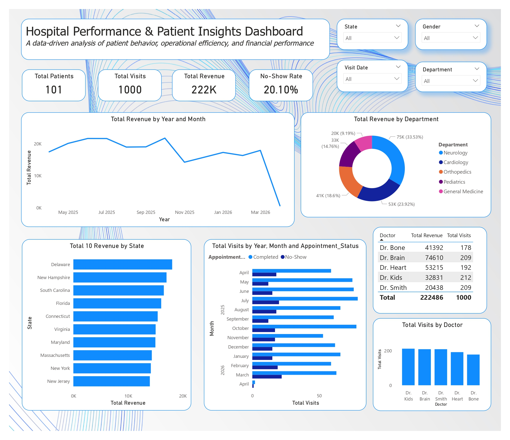

# 🏥 Healthcare Patient Engagement & Revenue Analysis (U.S. State-Based)
---

## 📸 Dashboard Preview



---
## 📌 Project Overview

This project presents an end-to-end healthcare data analysis workflow using **Excel, MySQL, and Power BI**, focusing on patient engagement, revenue performance, and operational insights across **U.S. states**.

The analysis explores how patient behavior, appointment outcomes, and financial performance vary by state, department, and doctor.

---

## 🎯 Objectives

* Analyze **patient engagement and retention**
* Identify **top-performing departments and doctors**
* Evaluate **performance across U.S. states**
* Track **revenue and visit trends over time**

---

## 🛠️ Tools & Technologies

* **Excel** – Data generation, cleaning, and feature engineering
* **MySQL** – Data storage, querying, and analysis
* **Power BI** – Dashboard creation and data visualization

---

## 📊 Dataset Description

The dataset simulates healthcare patient records with the following fields:

* Patient_ID
* Visit_ID
 * Full Name
* Gender
* Age
* Age Group
* Department
* Doctor
* Visit_Date
* Month-Year
* State (U.S. State)
* Appointment_Status (Completed / No-show)
* Revenue
* Patient Type (New / Returning)

---

## 🔄 Data Workflow

### 1. Excel

* Generated synthetic healthcare dataset using formulas
* Cleaned and standardized data
* Created derived columns (Age Group, Month-Year, Patient Type)

### 2. MySQL

* Imported dataset into database
* Performed data validation and transformation
* Wrote SQL queries for analysis:

  * Aggregations (SUM, COUNT)
  * Subqueries
  * Window functions (RANK, LAG)

### 3. Power BI

* Connected MySQL database to Power BI
* Built data model and created DAX measures
* Designed an interactive dashboard

---

## 🤖 Use of AI

AI tools were used to assist in:

* Created realistic synthetic healthcare dataset
* Used nested queries to calculate metrics such as returning patients
* Utilized DATE_FORMAT() to group data by month and year for time-based trend analysis
* Built logic for calculating percentage rates 
* Debugging errors in SQL and DAX
* Structuring calculations for Power BI

All outputs were manually validated and refined to ensure accuracy and reliability.

---

## 📈 Key Analyses

### 🔹 1. Engagement & Retention Analysis

* Total Patients
* Total Visits
* Returning vs New Patients
* No-show Rate

### 🔹 2. Category Contribution

* Revenue by Department
* Visit distribution by Department

### 🔹 3. State-Level Performance

* Revenue by U.S. State
* No-show trends by state
* Identification of high-performing states

### 🔹 4. Temporal Trend Analysis

* Monthly Revenue Trend
* Monthly Visit Trend
* Growth patterns over time

---

## 📊 Dashboard Features

* KPI Cards (Total Patients, Revenue, Visits, No-show Rate)
* Line Chart (Monthly Revenue Trend)
* Donut Chart (Department Contribution)
* Bar Chart (Revenue by State)
* Stacked Column Chart (Appointment Status Trends)
* Doctor Performance Chart (Top 5 Doctors)
* Interactive slicers (State, Department, Gender, Date)

---

## 🔍 Key Insights

* Revenue demonstrates a consistent upward trend over time
* Certain departments contribute a majority of total revenue
* Patient retention is observed through repeat visits
* No-show rates vary across U.S. states
* Top-performing doctors generate a significant portion of revenue
* State-level differences highlight opportunities for operational improvement

---
## Conclusion

The analysis of 1,000 patient appointment records from April 2025 to April 2026 provided insights into patient engagement, appointment attendance, departmental performance, and revenue generation.

Overall, **799 appointments (79.9%) were completed, while 201 appointments (20.1%) resulted in no-shows**. The dataset generated a total recorded revenue of **$222,486**, with an average revenue of approximately **$278.46 per completed appointment**.

Neurology generated the highest revenue at **$74,610**, followed by Cardiology at $53,215. However, Pediatrics recorded the highest appointment volume with 212 visits and also had the highest no-show rate at 23.1%. Orthopedics demonstrated the lowest no-show rate at 15.7%, suggesting stronger appointment attendance compared to the other departments.

Monthly trends showed that July 2025 had the highest appointment volume, with 99 visits, while March 2026 recorded the highest number of no-shows, with 22 appointments.

These findings highlight opportunities to improve appointment attendance, strengthen patient engagement, and identify operational areas that may benefit from closer monitoring. Overall, the analysis demonstrates how SQL and data visualization can transform raw healthcare data into meaningful insights that support operational and revenue-related decision-making.

## Recommendations

Based on the findings, the following recommendations could help improve patient engagement and operational performance:

**1. Reduce Patient No-Show Rates**

With 20.1% of appointments resulting in no-shows, implementing automated appointment reminders through SMS, email, or phone calls could help improve attendance. Monitoring no-show trends can also help identify patients or appointment periods that may require additional follow-up.

**2. Improve Appointment Engagement in Pediatrics**

Pediatrics recorded the highest no-show rate at 23.1%. The department could benefit from targeted appointment reminders, follow-up procedures, and improved scheduling coordination with parents or guardians.

**3. Monitor Departmental Revenue Performance**

Neurology generated the highest revenue at $74,610, while General Medicine generated the lowest at $20,438. Reviewing appointment volume, service utilization, and revenue patterns across departments could help identify opportunities to improve operational efficiency and resource allocation.

**4. Improve Appointment Scheduling and Resource Planning**

Monthly appointment trends can help healthcare administrators anticipate periods of higher patient demand. Using historical appointment data to support staffing and scheduling decisions may improve resource utilization and reduce scheduling inefficiencies.

**5. Strengthen Patient Retention Tracking**

Further analysis of first-time and returning patients could provide better insights into patient retention and engagement. Accurate patient visit history is important for identifying repeat visits and understanding long-term engagement patterns.

### Final Takeaway

This project demonstrates how healthcare appointment data can be analyzed using SQL to identify operational trends, measure patient engagement, evaluate departmental performance, and uncover potential areas for improvement.

**By combining data cleaning, SQL queries, aggregations, joins, calculated metrics, and data visualization, I was able to translate raw appointment records into actionable business insights. The project strengthened my ability to approach healthcare data from an analytical perspective and communicate findings that can support data-driven decision-making.
---

## 📁 Project Structure

```
/data        → csv dataset
/excel       → Excel file
/insights    → Dashboard screenshots     
/powerbi     → Power BI (.pbix file)  
/sql         → MySQL queries  
```


## 🚀 How to Use

1. Open the Excel dataset and review the data
2. Import data into MySQL
3. Run SQL queries for analysis
4. Connect MySQL to Power BI
5. Build and interact with the dashboard

---

## 💡 Skills Demonstrated

* Data Cleaning & Preparation
* SQL Querying (Aggregations, Subqueries, Window Functions)
* Data Modeling in Power BI
* DAX Calculations
* Data Visualization & Storytelling

---

## 🔮 Future Improvements

* Add predictive analytics (forecasting trends)
* Include patient diagnosis and treatment data
* Implement cohort-based retention analysis

---

## 👤 Author

Adriane Clark Ballesteros  
Healthcare Data Analyst Trainee

* 🔗 GitHub: https://github.com/acbshields12

---
